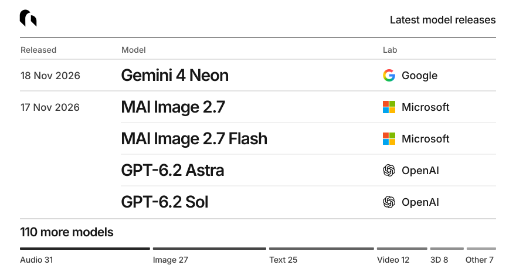

<picture>
  <source media="(max-width: 680px)" srcset="./.github/images/release-index-mobile.svg">
  
</picture>

# Models

**A hand-curated, source-backed catalogue of AI models.**

Explore model capabilities, limits, provider IDs, and published prices, with links to
the original sources.

[Get the catalogue](#get-the-catalogue) · [Browse models](https://grida.co/ai/models) · [View releases](https://github.com/gridaco/models/releases)

## Get the catalogue

Every change to the catalogue on `main` is published as a
[release](https://github.com/gridaco/models/releases) and as the npm package
[`@grida/ai-models`](https://www.npmjs.com/package/@grida/ai-models), which holds the same
files and no code.

```sh
npm install @grida/ai-models
```

Use JSON import attributes in Node.js ESM. The agent catalogue import requires a v2
release that includes `agents.json`.

```js
import models from "@grida/ai-models/models.json" with { type: "json" };
import agentCatalogue from "@grida/ai-models/agents.json" with { type: "json" };
```

Agent Models lists documented primary model selectors by agent. Resolve its canonical
model IDs against `models.json` from the same snapshot. The agent's live discovery
supplies the choices for the current account. [Agent Models contract](./catalogue/README.md#agent-models) · [Claude Agent SDK example](./catalogue/README.md#join-claude-agent-sdk-models)

For fetching at runtime, use the package through jsDelivr's CDN: compressed, cached at the
edge, and with no redirects. `@2` follows the newest snapshot of schema version 2; a full
version pins one snapshot.

```
https://cdn.jsdelivr.net/npm/@grida/ai-models@2/models.json
https://cdn.jsdelivr.net/npm/@grida/ai-models@2/agents.json
https://cdn.jsdelivr.net/npm/@grida/ai-models@2/schemas/agents.schema.json
```

Pin the URLs to the same full version when the files are used together.

The GitHub Release assets suit scripts and archiving. The newest snapshot is always at:

```sh
curl -LO https://github.com/gridaco/models/releases/latest/download/models.v2.json
curl -LO https://github.com/gridaco/models/releases/latest/download/labs.v2.json
curl -LO https://github.com/gridaco/models/releases/latest/download/agents.v2.json
```

The `v2` in the file name is the schema version. GitHub `latest` follows the newest
release across schema majors. Assets keep versioned names, so an old asset name
stops resolving after a major change instead of serving a different shape. To pin
a snapshot, use its version instead of `latest`:
`https://github.com/gridaco/models/releases/download/<version>/models.v2.json`.

Agent Models is published with the following catalogue assets.

| asset                                          | contents                                                                                      |
| ---------------------------------------------- | --------------------------------------------------------------------------------------------- |
| `models.v2.json`, `labs.v2.json`               | Model cards and labs (`catalogue/models.json`, `catalogue/labs.json`)                         |
| `agents.v2.json`                               | Primary model selectors by agent (`catalogue/agents.json`)                                    |
| `models.v2.schema.json`, `labs.v2.schema.json` | Their JSON Schemas                                                                            |
| `agents.v2.schema.json`                        | JSON Schema for Agent Models, also at `@grida/ai-models/schemas/agents.schema.json`           |
| `grida-models-<version>.tar.gz`, `.zip`        | The whole catalogue, logos included, with `LICENSE` and `manifest.json`                       |
| `manifest.json`                                | Version, schema version, source commit, content digest, counts, and the SHA-256 of every file |
| `SHA256SUMS`                                   | Checksums of the other assets: `sha256sum -c SHA256SUMS --ignore-missing`                     |

Versions read `v<schema>.<YYYYMMDD>.<n>`: the schema version,
the UTC date of the source commit, and a counter for snapshots on the same day. They are valid
semver, so a range such as `^2` follows every snapshot without crossing a breaking schema
change. A release is published only when the catalogue's content changes, and the archives
are reproducible from the same commit. Release notes list the models, labs, schemas, and
other files that changed since the previous release.

[Schema changelog](./catalogue/SCHEMA_CHANGELOG.md) · [Migrate from v1](./catalogue/SCHEMA_CHANGELOG.md#migrating-from-schema-version-1)

The catalogue data is MIT licensed. Lab logos are trademarks of their owners and are not
covered by that license.

Snapshots record public model facts. To see which models Grida currently serves,
use [Gateway discovery](https://gateway.grida.ai/v1/models).

When updating a consumer, handle unfamiliar optional display metadata gracefully rather
than reject the whole catalogue. Execution and pricing fields still need explicit support.
Coordinate breaking contract changes with consumer updates.

## Why

Model metadata fragments quickly. The same model ID, context window, price, or release date
ends up in an application package, a gateway's route table, a pricing page, a marketing
section, and a CLI, and each copy drifts on its own schedule. A stale entry is not a
conservative answer; it is a wrong one.

This repository is meant to be the single place those facts are authored. Everything else
consumes a projection of it.

## What is in a catalogue entry

| Kind                      | Examples                                                                                |
| ------------------------- | --------------------------------------------------------------------------------------- |
| **Identity**              | Canonical ID (`vendor/model`), label, vendor, family (text, image, video, audio, 3D, …) |
| **Release provenance**    | First broad public release date, its basis, and the first-party source URL              |
| **Capabilities**          | Modalities, accepted image formats, tool calling, audio, transparent background         |
| **Limits**                | Context window, output limit, sizes, aspect ratios, durations, size constraints         |
| **Provider bindings**     | Exact provider IDs, a native API reference, and sourced coverage/exclusion reasons      |
| **Model distribution**    | Official code and weight links, exact variants, access conditions and separate licenses |
| **Published prices**      | Public list prices per provider, in the provider's own billing unit                     |
| **Published calculators** | Sourced output-token formulae, examples, and image-input tokenization rules             |

## What it is not

- **Not a router or SDK.** A provider binding records that an endpoint exists and what it
  costs. It does not implement a client or grant permission to call it.
- **Not billing execution.** The catalogue holds publicly advertised regular prices,
  including Grida's public service price. Funding fees, credit conversion, margins,
  supplier selection and negotiated/account-specific rates stay with their owners.
- **Not a live mirror.** Nothing is scraped into this repository automatically. Discovery
  tools such as [models.dev](https://models.dev) give leads; a person verifies each fact
  against a first-party source.
- **Not an endorsement.** Being catalogued does not mean any Grida product offers the model.
  Which models a product lists, and in what order, is that product's decision.

Each model is authored as one TOML card in [`models/`](./models/), grouped by lab
([`models/openai/gpt-6.2-astra/card.toml`](./models/openai/gpt-6.2-astra/card.toml)). The contract consumers read,
[`catalogue/models.json`](./catalogue/models.json), is generated from those cards: plain JSON
with a JSON Schema, readable from any language. Its shape and rules are documented in
[`catalogue/README.md`](./catalogue/README.md).

## Contributing

See the [contributor guide](./CONTRIBUTING.md).

## License

[MIT](./LICENSE). The lab logos in `models/` and `catalogue/logos/` are trademarks of their
owners and are not covered by this license; each lab's entry links its source and, where
published, its brand guidelines.
